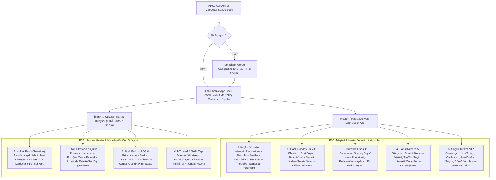

# LARİ Gerçek Mobil Uygulama Deneyimi Planı (Web Klonu Değil, Native Yaşam & İş Asistanı)

> [!IMPORTANT]
> **Teşhis & Özelleştirilmiş Kök Neden:**
> 1. **Neden Telefonda Direkt Web Sitesini Gördün?**
>    Az önce indirdiğin APK açıldığında `https://app.randevulari.com/#/` (kök `/` rotası) adresini yükledi. `App.tsx` içindeki `/` rotası ise Capacitor/Mobil ortam kontrolü yapmadığı için seni `/m` mobil uygulama kabuğuna sokmak yerine doğrudan **mevcut web sitesinin ana/randevu sayfasına (`MarketingHomePage` / `/book`)** yönlendirdi. Yani telefonda gerçekten de web sitesinin kendisi açıldı; Marketplace ve diğer mobil ekranlara hiç girmedi.
> 2. **Daha Önemli Ürün Gerçeği:**
>    `/m` rotası açılmış olsaydı bile, ilk turda 25 dakikada ürettiğimiz ekranlar "servis ve veri kontratlarını doğrulayan sade bilgi kartları" seviyesindeydi. Oysa mobil uyumlu bir web sitesi varken kullanıcının **LARİ uygulamasını telefonuna indirmesi ve silmemesi** için uygulamanın **web sitesinde olmayan, tamamen telefona özgü bir deneyim ve his (tactile native UX)** sunması gerekir.

---

## 1. Temel Felsefe: "Web Sitesi Randevu Formudur, LARİ Uygulaması İse Kişisel Güzellik, Sağlık ve İşletme Asistanıdır"

| Boyut | Mobil Web Sitesi (`randevulari.com`) | LARİ Gerçek Mobil Uygulama (`APK / iOS App`) |
| :--- | :--- | :--- |
| **Açılış & Kimlik** | Pazarlama sayfası, fiyatlar, footer, uzun form | **Sıfır Web İzi:** Tam ekran Hikaye (Story) Onboarding, Biyometrik / OTP giriş, son kalınan ekrandan anında devam |
| **Keşif (Marketplace)** | Tek işletmenin klasik randevu sayfası | **Harita + Kaydırılabilir Vitrin (Uber/Airbnb hissi):** Canlı pin'ler, "Şu An Yakınımda Boş Koltuk (Flash Slots)", Önce/Sonra Reels vitrini, Uzman portfolyoları |
| **Randevu Günü** | Sadece SMS/WhatsApp linki | **Canlı Randevu Asistanı (Live Companion):** Geri sayım, trafik/yol tarifi, salona girince **Tek Dokunuş QR Check-in**, **VIP İkram & Seans Tercihi** *(Kahve/Çay, Sessiz Seans, Müzik seçimi)* |
| **Kişisel Hafıza** | Yok (Her randevu bağımsız form) | **Güzellik & Sağlık Pasaportu (My Care Timeline):** *"3 ay önce saçımın dibine hangi boya formülü sürüldü?"*, *"Hangi dişime işlem yapıldı?"*, Önce/Sonra fotoğraf arşivi ve ev-bakım ürün hatırlatıcısı |
| **AI & Kamera** | Dosya yükleme kutusu | **Canlı Kamera Vizörü & Önce/Sonra Slider:** Yüz hizalama çerçeveli kamera, kaydırılabilir (draggable) Before/After karşılaştırma, renk/gülüş tonu paleti |
| **Cüzdan & Sadakat** | Basit bakiye satırı | **Apple Wallet Tarzı Kart Destesi:** Damgalı sadakat kartları (*"4/5 Bakım Tamam, 5. Hediye"*), animasyonlu seans barı, WhatsApp'tan zarflı dijital hediye kartı gönderme |
| **Uzman / Doktor (B2B)** | Masaüstü tablo/panel daraltması | **Koltuk Başı (Chairside) Cep Stüdyosu:** Müşteri koltuğa oturduğunda alerji/boya formülü/kahve tercihi kartı, hasta fotoğrafı üzerinde **parmakla çizim/işaretleme kanvası**, kameradan barkod okutup 3 saniyede tahsilat |

---

## 2. Uygulama Mimarisi & Ekran Akışı (Native Navigation Graph)

---

## 3. Faz Faz "Gerçek Uygulama" Geliştirme Planı (Faz UX-1 .. UX-6)

### Faz UX-1: Native Boot Kilidi, Görsel Onboarding ve Akıcı Uygulama İskeleti (`App-Only Entry`)
- **Kök Rota (`/`) Native Kilidi:** `App.tsx` içinde uygulama `app.randevulari.com`, `Capacitor.isNativePlatform()` veya `?app=1` ile açıldığında **asla** `MarketingHomePage` veya web `/book` sayfasına düşmez; doğrudan Native Uygulama Kabuğunu başlatır.
- **Tam Ekran Onboarding & Rol/Deneyim Seçici:** Uygulama ilk açıldığında kullanıcıyı karşılayan; Güzellik & Wellness, Klinik & Muayenehane, Sağlık Turizmi ve Partner Stüdyosu dünyalarını tanıtan kaydırılabilir (swipeable) karşılama deneyimi.
- **Native Hissiyatlı Alt Bar, Cam Efektli (Glassmorphic) Başlıklar ve Kaydırılabilir Bottom Sheet Mimarisi:** Web sayfası gibi yukarıdan aşağıya düz akan kutular yerine; sabit uygulama başlığı, akıcı sekme geçişleri, dokunma geri bildirimi (`active:scale-95` micro-interactions) ve tam ekran açılan işletme/işlem çekmeceleri (sheets).

### Faz UX-2: Gerçek Marketplace & İşletme Vitrin Deneyimi (Harita + Flash Saatler + Zengin Mağaza Sayfası)
- **İnteraktif Harita & Liste Görünümü (`Harita / Liste` Geçişi):**
  - Harita üzerinde salon, berber, spa ve klinik pin'leri (fiyat seviyesi, puan ve *"Bugün 15:30"* rozetleriyle). Pin'e dokunulduğunda altta mini önizleme kartı açılır.
- **"Son Dakika Boş Koltuklar (Flash Deals & Instant Slots)":**
  - Yakındaki işletmelerde bugün iptalden boşalan veya hemen girilebilecek saatler için yatay kaydırılabilir *"Şu An Müsait"* vitrini.
- **Zengin İşletme Detay Vitrini (Full-Screen Storefront Drawer):**
  - Bir işletmeye dokunulduğunda sadece "Randevu Al" popup'ı değil; işletmenin **Kapak Görselleri & Atmosfer Galerisi**, **Uzman Ekibi (Hangi uzman neyde usta, puanı, portfolyosu)**, **Kategorili Hizmet Menüsü**, **Doğrulanmış Müşteri Yorumları** ve **Konum/Çalışma Saatleri** içeren tam teşekküllü bir mağaza ekranı açılır.
- **Çok Adımlı Akıcı Randevu Çekmecesi:** Hizmet(ler) seçimi → Uzman seçimi (görsel avatarlarla) → Tarih/Saat slot matrisi → VIP Ağırlama Tercihi → Onay & Cüzdana QR Pass ekleme.

### Faz UX-3: "Canlı Randevu Asistanı (Live Companion)" & "Güzellik/Sağlık Pasaportu"
- **Canlı Randevu & VIP Ağırlama Kartı:**
  - Yaklaşan randevu için canlı durum çubuğu (*"Randevu Onaylandı → Yola Çıkma Zamanı → Salonda Check-in Yapıldı → İşlemde → Tamamlandı"*).
  - **VIP Konfor & İkram Seçici:** Müşteri daha salona varmadan uygulama üzerinden ikramını (*Filtre Kahve, Bitki Çayı, Su, İkram İstemiyorum*) ve seans modunu (*"Sessiz / Dinlenme Seansı"* veya *"Sohbet & Danışmanlık"*) seçer; bu bilgi uzmanın ekranına düşer.
- **Kişisel Güzellik & Sağlık Pasaportu (My Care Passport):**
  - Geçmiş işlemlerin sadece tarih/fiyat olarak değil; **Uygulanan Boya/Bakım Formülü** (*Örn: "Dip: 7.1 Küllü Kumral + Uçlar: Tonlama 9.12"*), **Hekim/Uzman Tavsiyesi**, **Önce/Sonra Fotoğraf Çifti** ve **Ev Devam Ürünü Kullanım Takvimi** (sabah/akşam tik atılabilen rutin listesi) ile saklanması.

### Faz UX-4: Gerçek Kamera Vizörlü AI Stüdyosu & Apple Wallet Tarzı Kart Destesi
- **Canlı Kamera & İnteraktif Önce/Sonra (Before/After Slider) AI Stüdyosu:**
  - Telefon kamerasını (`getUserMedia` + fotoğraf yükleme/hazır model portreleri) yüz hizalama rehberiyle açan vizör.
  - Parmağınla sağa-sola kaydırarak **Önce / Sonra** görünümünü canlı karşılaştırma sürgüsü (interactive comparison slider) ve alt kısımda **Canlı Ton/Stil Kartelası** (*Karamel Balayage, Platin Buz, Hollywood Gülüş OM1, Doğal Zirkonyum B1, Skin Fade*).
- **Apple Wallet Hissiyatlı Kart Destesi (Stacked Cards):**
  - Üst üste dizilmiş, dokununca öne açılan dijital kartlar: **Offline QR Check-in Kartı**, **Damgalı Sadakat Kartı (5'li animasyonlu damga)**, **Seans Paketi Takip Kartı** ve **WhatsApp Paylaşımlı Dijital Hediye Zarfı**.

### Faz UX-5: Uluslararası Sağlık Turizmi "VIP Cep Concierge" Deneyimi
- **Seyahat & Tedavi Canlı Zaman Tüneli:** Uçuş kodu, havalimanı karşılama kapısı, VIP transfer aracı plakası ve şoför iletişim kartı, 5 yıldızlı otel rezervasyon kodu.
- **Pre-Op & Post-Op Akıllı İyileşme Asistanı:** Operasyon öncesi hazırlık kontrol listesi ve operasyon sonrası **1. Gün / 3. Gün / 7. Gün / 30. Gün kontrol fotoğrafı çekip koordinatöre/hekime gönderme** akışı.

### Faz UX-6: İşletme, Uzman ve Hekim İçin "Koltuk Başı (Chairside) Partner Stüdyosu"
- **Koltuk Başı Müşteri Kartı:** Uzman randevuya dokunduğunda müşterinin VIP ikram tercihini (*"Filtre Kahve, Sessiz Seans"*), geçmiş boya/işlem formülünü, alerji/hassasiyet uyarısını tek ekranda görür ve yeni seans formülünü tek dokunuşla müşterinin pasaportuna işler.
- **Dokunmatik Konsültasyon & İşaretleme Kanvası (`HTML5 Touch Canvas`):** Hekim veya uzman, konsültasyon sırasında fotoğraf üzerinde parmağıyla çizim/işaretleme (saç çizgisi, dolgu/botoks noktaları, diş hattı, kesim hattı) yapabilir, renk seçebilir, geri alabilir ve bunu doğrudan hasta/müşteri dosyasına kaydedebilir.
- **Hızlı Barkod/Kamera POS & Canlı Uzman Prim Kartı:** Uzmanın o gün yaptığı işlemlerden kazandığı net primi canlı halkasal grafikte (progress ring) görmesi ve tek dokunuşla hizmet + ürün adisyonu kapatması.
