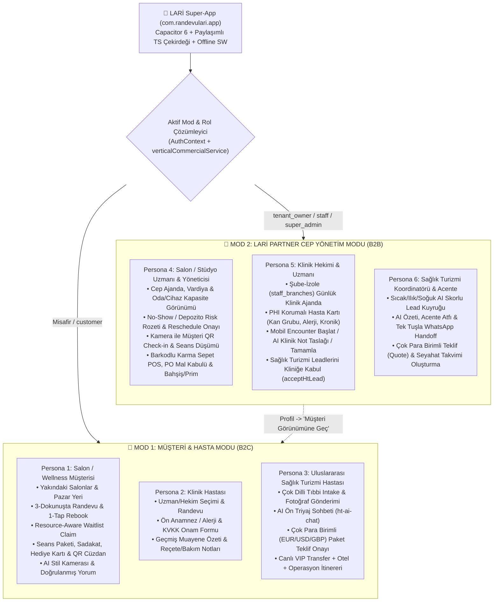
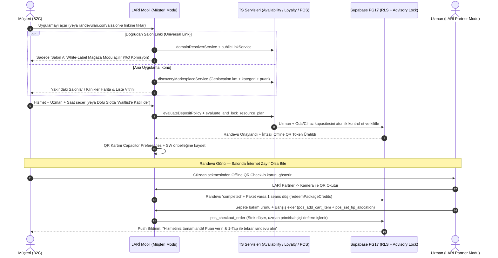
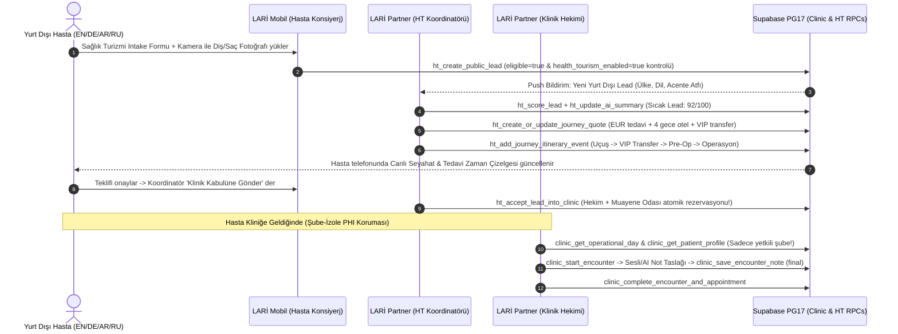
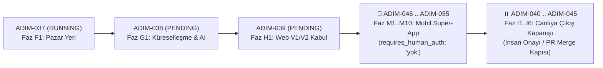

# 📱 LARİ (`randevulari.com` & `lari.app`) — Uçtan Uca Çok Dikeyli Mobil Super-App Production Master Planı (Faz M1..M10 / `ADIM-046..055`)

> [!IMPORTANT]
> **Neden Önceki Plan Eksikti ve Bu Plan Neyi Değiştiriyor?**
> Bu PC'deki yerel repo `ADIM-018`'de kalmıştı; ancak `MertSGI/Otonom-Proje-Sync` ve `MertSGI/Randapp-main` (`ci/lari-independent-acceptance-gate` @ `6824aa81`) üzerindeki **gerçek 45 adımlık (`ADIM-001..045`)** üretim ağacının tamamı çekilip incelendiğinde LARİ'nin yalnızca bir "kuaför randevu uygulaması" değil; **4 ana dikeyde çalışan çok kiracılı, çok para birimli, sunucu-yetkili (DB-Authoritative) bir Hizmet, Klinik, Sağlık Turizmi, POS/Envanter ve Pazar Yeri Platformu** olduğu doğrulandı.
> Ayrıca canlı kuyrukta **`ADIM-040..045` zaten Faz I1..I6 (Release Closure)** için dolu olduğundan, Mobil Üretim Programı çakışmasız olarak **`ADIM-046..055` (Faz M1..M10)** numaralandırmasıyla ve `ADIM-039` (`SOURCE_CANDIDATE_COMPLETE`) hemen sonrasına bağlanacak şekilde kurgulandı.

---

## BÖLÜM 1: Rakip Analizi & LARİ Mobil'i Rakiplerden Ayıran 7 Yıkıcı Fark

Piyasadaki mevcut rakipler (**Fresha, Booksy, KolayRandevu,Treatwell, Doctolib, WhatClinic**) tek bir dikeye sıkışmış durumdadır. LARİ Mobil (`com.randevulari.app`) ise mevcut V1+V2 backend çekirdeğimizdeki benzersiz RPC ve servisleri kullanarak rakiplerin yapamadığı şu **7 somut üstünlüğü** tek uygulamada sunar:

| # | Ayrışma Noktası | Rakipler (Fresha / Booksy / Doctolib) Ne Yapıyor? | LARİ Mobil (`com.randevulari.app`) Ne Yapıyor? | Bağlı Olduğu Mevcut LARİ Modülü |
| :--- | :--- | :--- | :--- | :--- |
| **1** | **Dikey-Adaptif Polimorfik Kabuk (`Vertical-Adaptive UX`)** | Kuaför uygulamasıyla diş kliniği veya sağlık turizmi yönetilemez; her sektör için ayrı uygulama gerekir. | İşletmenin `resolve_tenant_vertical_context` yetkisine göre arayüz kabuğu dinamik dönüşür: **Salon/Spa**'da *Stil Kamerası & Seans Paketi*, **Klinik**'te *Hekim/Encounter & PHI Hasta Kartı*, **Sağlık Turizmi**'nde *Uçuş-Otel-VIP Transfer-Operasyon İtinereri* açılır. | `verticalCommercialService.ts`, `clinicUiPolicy.ts`, `marketConfigService.ts` |
| **2** | **Sıfır Komisyonlu "Kendi Mağazan" + Pazar Yeri Hibriti** | Fresha, işletmenin kendi Instagram linkinden gelen yeni müşteriden bile %20 pazar yeri komisyonu keser; işletmeler tepkilidir. | Müşteri `randevulari.com/:slug` veya QR üzerinden geldiğinde uygulama **yalnızca o işletmeye kilitli White-Label mağaza** gibi açılır (rakip salon önermez, %0 komisyon). Uygulama ana ikonundan açıldığında ise **Keşif Pazar Yeri** modunda çalışır. | `domainResolverService.ts`, `publicLinkService.ts`, `discoveryMarketplaceService.ts` |
| **3** | **Fiziksel Oda & Cihaz Kilitli Akıllı Bekleme Listesi (`Atomic Resource Waitlist`)** | Sadece "Personel boşaldı" bildirimi atar; aynı lazer cihazını veya muayene odasını kullanan başka randevu varsa çakışma olur. | İptal olan slotta hem uzman hem de zorunlu **Oda/Cihaz (`appointment_resources`)** kapasitesini kontrol eder; push bildirime ilk dokunan müşteriye `claim_waitlist_slot` ile odayı ve uzmanı aynı PG transaction'ında atomik kilitler. | `bookingInterval.ts`, `20260910_phase3_waitlist_foundation.sql`, `20260912_phase3_resource_capacity_foundation.sql` |
| **4** | **Donanımsız Cep POS, Seans Paketi, Stok & Bahşiş Mutabakatı** | Telefondan sadece randevu takvimi görünür; ürün satışı, tedarikçi mal kabulü ve prim/bahşiş için masaüstü bilgisayar şarttır. | Uzman telefon kamerasıyla müşterinin **QR Check-in** kodunu veya **ürün barkodunu** okutur: Randevu tamamlanır, seans paketinden 1 hak düşer (`redeemPackageCredits`), şampuan/bakım ürünü sepete eklenip stoktan düşer (`pos_decrement_stock_for_sale`) ve bahşiş personele yazılır (`pos_set_tip_allocation`). | `posInventoryService.ts`, `loyaltyReactivationService.ts`, `20260916..20260919` migrasyonları |
| **5** | **Şube-Korumalı (PHI) Hekim Cep Muayene & AI Klinik Not Asistanı** | Doktor/uzman hasta geçmişini görmek ve muayene notu yazmak için masaüstü PC'ye mahkumdur; çok şubeli kliniklerde tüm şube hastaları birbirine karışır. | Hekim sadece `staff_branches` ile yetkili olduğu şubenin hastalarını görür (`ADIM036-PHI-006` garantisi), telefondan `startClinicEncounter` başlatır, sesli/kısa not girer, `clinicAiAssistService` ile yapılandırılmış klinik taslak üretip imzalar. | `clinicService.ts`, `clinicAiAssistService.ts`, `20260928..20260930` migrasyonları |
| **6** | **Cep Medikal Konsiyerj (Sağlık Turizmi Canlı Seyahat & Teklif Cüzdanı)** | Yurt dışı hastalarla WhatsApp'ta dağınık PDF ve mesajlarla konuşulur; hasta uçaktan inince nereye gideceğini, ne zaman kan vereceğini şaşırır. | Hastanın telefonunda kendi dilinde (`EN/DE/AR/RU/TR`) ve para biriminde (`EUR/USD/GBP`) **onaylı tedavi+otel teklifi (`ht_create_or_update_journey_quote`)** ve **canlı adım adım seyahat takvimi (`ht_add_journey_itinerary_event`)** + tek tuşla koordinatör/WhatsApp devri (`ht_enqueue_whatsapp_handoff`) bulunur. | `utils/healthTourismService.ts`, `types/healthTourism.ts`, `20261001..20261007` migrasyonları |
| **7** | **3-Kademeli Dürüst Durum & Fail-Closed Offline Kalkanı** | İnternet koptuğunda veya ödeme/SMS sağlayıcısı hata verdiğinde uygulama çöker ya da sahte "başarılı" mesajı gösterir. | Her modül `LIVE_ACTIVE | LOCAL_OR_SANDBOX_ONLY | DISABLED_EXTERNAL_HOLD` rozetini dürüstçe taşır; offline durumda bile imzalı QR Check-in kartı, yaklaşan randevu ve seyahat itinereri yerel şifreli önbellekten (`Capacitor Preferences` + `Service Worker`) açılır. | `adminFeatureAvailabilityService.ts`, `communicationDeliveryService.ts` |

---

## BÖLÜM 2: Uçtan Uca Mimari — Tek Uygulama (`com.randevulari.app`), 2 Ana Mod, 6 Persona

Uygulama tek bir binary (`com.randevulari.app`) olarak çıkar; ancak oturum açan kullanıcının rolüne (`Role`: `customer | staff | tenant_owner | super_admin`) ve işletmenin dikey yetkilerine (`verticals.clinic_enabled`, `verticals.health_tourism_enabled`) göre **6 alt persona deneyimi** sunar:

---

## BÖLÜM 3: Eksiksiz Modül, Servis, RPC ve Eklenti Bağlantı Matrisi

Hiçbir ekran "soyut" kalmayacak şekilde; her mobil ekranın bağlanacağı **mevcut TypeScript servisi**, **Supabase SQL RPC'si** ve **Capacitor Native Eklentisi** aşağıda kilitlenmiştir:

| Mobil Ekran / Bileşen | Bağlanacağı Mevcut TS Servisi | Çağrılacak Sunucu-Yetkili RPC / Tablo | Kullanılacak Native Eklenti & Özellik |
| :--- | :--- | :--- | :--- |
| **`MobileExploreMarketplacePage.tsx`** *(B2C Keşif & Pazar Yeri)* | `discoveryMarketplaceService.ts`, `publicLinkService.ts`, `marketConfigService.ts` | `search_discovery_marketplace`, `get_public_salon_storefront` | `@capacitor/geolocation` (Haversine km hesabı), `@capacitor/app` (Universal Link `/#/s/:slug` yakalama) |
| **`MobileBookingSheet.tsx`** *(B2C Randevu, Kaynak & Waitlist)* | `availabilityService.ts`, `bookingInterval.ts`, `appointmentService.ts`, `publicBookingOtpService.ts`, `loyaltyReactivationService.ts` | `create_public_booking`, `evaluate_and_lock_resource_plan`, `claim_waitlist_slot`, `evaluateDepositPolicy` | `@capacitor/haptics` (slot seçimi/onay titreşimi), WebOTP / SMS otomatik doldurma |
| **`MobileCustomerWalletPage.tsx`** *(B2C Cüzdan, QR, Paket, Sadakat, Yorum)* | `appointmentSelfServiceService.ts`, `loyaltyReactivationService.ts`, `customerCampaignService.ts`, `discoveryMarketplaceService.ts` | `redeem_package_credits`, `transact_wallet_balance`, `redeem_gift_card`, `submit_verified_review` | `@capacitor/preferences` (Offline imzalı QR saklama), `@capacitor/share` (Referans kodu & `.ics` paylaşımı) |
| **`MobileAIStyleAndHealthIntakePage.tsx`** *(B2C AI Stil + HT Tıbbi Intake)* | `geminiService.ts`, `utils/healthTourismService.ts`, `utils/countryHelper.ts`, `currencyService.ts` | `ht_create_public_lead`, `ht_create_ai_conversation`, Edge: `ai-visualization`, `ht-ai-chat` | `@capacitor/camera` (Saç/Cilt/Diş fotoğrafı çekme & sıkıştırma) |
| **`MobileHtPatientJourneyPage.tsx`** *(B2C Sağlık Turizmi Cep Konsiyerj)* | `utils/healthTourismService.ts`, `utils/healthTourismTranslations.ts` | `ht_get_patient_journey`, `ht_enqueue_whatsapp_handoff` | `@capacitor/local-notifications` (Uçuş/Transfer/Pre-Op geri sayım hatırlatıcıları) |
| **`MobilePartnerAgendaAndInboxPage.tsx`** *(B2B Salon & Klinik Cep Ajandası)* | `adminAppointmentService.ts`, `adminRescheduleService.ts`, `bookingAbuseProtectionService.ts`, `reportingService.ts` | `get_tenant_booking_analytics`, `claim_waitlist_slot`, `appointment_resources` | `@capacitor/push-notifications` (Yeni randevu/erteleme anlık bildirimi), Swipe-to-Approve |
| **`MobilePartnerPosAndInventoryPage.tsx`** *(B2B QR Check-in, Karma POS & Stok)* | `posInventoryService.ts`, `loyaltyReactivationService.ts` | `pos_create_order`, `pos_add_cart_item`, `pos_checkout_order`, `pos_set_tip_allocation`, `pos_receive_purchase_order_items` | `@capacitor/camera` / `BarcodeDetector` (Müşteri QR Check-in & Ürün barkodu okuma) |
| **`MobilePartnerCustomer360Page.tsx`** *(B2B Müşteri 360 CRM & Reaktivasyon)* | `customer360Service.ts`, `loyaltyReactivationService.ts`, `customerCampaignService.ts` | `get_customer_360_view`, `scan_reactivation_cohorts`, `grant_customer_package` | `@capacitor/biometric-auth` (Müşteri PII/finansal geçmiş görüntüleme öncesi FaceID/TouchID kilidi) |
| **`MobileClinicPractitionerPage.tsx`** *(B2B Hekim/Uzman Muayene & PHI)* | `clinicService.ts`, `clinicUiPolicy.ts`, `clinicAiAssistService.ts` | `clinic_get_operational_day`, `clinic_get_patient_profile`, `clinic_start_encounter`, `clinic_save_encounter_note`, `clinic_complete_encounter_and_appointment` | Mikrofon / Sesli Not (`clinic-ai-transcribe` / `clinic-ai-draft`), `staff_branches` PHI izolasyonu |
| **`MobileHtCoordinatorPage.tsx`** *(B2B Sağlık Turizmi Lead Ops & Teklif)* | `utils/healthTourismService.ts`, `clinicService.ts`, `verticalCommercialService.ts` | `ht_update_lead_status`, `ht_score_lead`, `ht_update_ai_summary`, `ht_create_or_update_journey_quote`, `ht_add_journey_itinerary_event`, `ht_accept_lead_into_clinic` | Push Handoff Uyarısı, Çok Para Birimli (`EUR/USD/GBP/TRY`) anlık teklif paylaşımı |

---

## BÖLÜM 4: Uçtan Uca Kullanıcı ve İşletme Akış Diyagramları

### Akış 1 — B2C Müşteri: Keşif / Doğrudan Salon Linki → Depozitolu/Paketli Randevu → Offline QR Check-in → Karma POS & Doğrulanmış Yorum

### Akış 2 — Klinik & Uluslararası Sağlık Turizmi: Yurt Dışı Hasta Başvurusu → AI Triyaj → Teklif & İtinerer → Klinik Hekim Kabulü & Encounter

---

## BÖLÜM 5: Kesin ve Yol Gösterici 10 Adımlık AutoDev Üretim Planı (`ADIM-046` → `ADIM-055`)

Canlı `Otonom-Proje` kuyruğunda `ADIM-001..036` `PASS`, `ADIM-037` `RUNNING`, `ADIM-038..039` `PENDING` ve `ADIM-040..045` insan onayı gerektiren **Faz I (Release Closure)** adımlarıdır.
Aşağıdaki **10 Mobil Üretim Adımı (`ADIM-046..055` / Faz M1..M10)**, `ADIM-039` biter bitmez (`ADIM-040` insan onay kapısına gelmeden hemen önce) **%100 otonom ve sıfır insan müdahalesiyle** çalışacak şekilde tanımlanmıştır:

---

### 🔹 `ADIM-046` (Faz M1): Capacitor 6, Gerçek PWA, Offline SW & `com.randevulari.app` Çekirdek Kurulumu
* **Eklentiler & Yapılandırma:**
  * `capacitor.config.ts`: `appId: 'com.randevulari.app'`, `appName: 'LARİ'`, `webDir: 'dist'`, `server: { hostname: 'app.randevulari.com', androidScheme: 'https', iosScheme: 'capacitor' }`.
  * `public/manifest.json`: Sahte `picsum.photos` URL'leri kaldırılır; `public/icons/icon-192.png`, `icon-512.png`, `maskable-512.png`, `apple-touch-icon.png` ve hızlı aksiyon kısayolları (`Randevu Al`, `Cüzdanım`, `Partner Ajanda`) tanımlanır.
  * `public/sw.js` & `services/mobile/pwaOfflineVaultService.ts`: App Shell önbellekleme + aktif randevu, imzalı QR Check-in kartı ve sağlık turizmi seyahat itinererini offline durumda sunan şifreli/versiyonlu yerel önbellek.
  * `public/.well-known/apple-app-site-association` & `public/.well-known/assetlinks.json`: `randevulari.com`, `app.randevulari.com`, `*.randevulari.com` ve `lari.app` Universal/App Links eşleşmeleri.
* **Kabul Kriterleri & Doğrulama (`scripts/verify-mobile-m1-foundation.mjs`):**
  1. `manifest.json` içinde hiçbir harici placeholder (`picsum.photos`) kalmamalı; tüm ikon dosyaları diskte mevcut ve `size > 0` olmalı.
  2. `domainResolverService.parseHostname('app.randevulari.com')` ve `marketConfigService` Capacitor hostname ile sıfır kırılmayla çalışmalı.
  3. Offline önbellek servisi internet yokken (`navigator.onLine = false` simülasyonu) kaydedilmiş randevu ve QR verisini kayıpsız döndürmeli.

---

### 🔹 `ADIM-047` (Faz M2): Birleşik Native Cihaz Köprüsü (`nativeBridgeService.ts`), Biyometrik Kilit & Deep Link Router
* **Eklentiler & Servisler:**
  * `types/mobileContracts.ts` & `services/mobile/nativeBridgeService.ts`:
    * **Geolocation Köprüsü:** Contextual permission (uygulama açılışında değil, kullanıcı "Yakınımdakiler"e bastığında izin ister) + Haversine mesafe (km) ve tahmini süre hesaplayıcı.
    * **Camera & Barcode/QR Köprüsü:** Fotoğraf çekme/sıkıştırma (AI Stil & Sağlık Turizmi tıbbi fotoğraf için max `1280px` JPEG) ve QR/Barkod tarayıcı (`BarcodeDetector` + kamera fallback).
    * **Biometric Security Köprüsü:** Klinik PHI hasta kartı, Müşteri 360 finansal geçmişi ve Partner POS ekranlarına girerken FaceID / TouchID / Cihaz PIN doğrulaması (`requireBiometricReauth`).
    * **Haptics, Share & Calendar (`.ics`) Köprüsü:** Randevu onayı titreşimi, referans linki paylaşımı ve Apple/Google Takvim'e tek tıkla etkinlik indirme.
  * `services/mobile/deepLinkRouterService.ts`: `randevulari://s/:slug`, `https://randevulari.com/:slug`, `randevulari://appointment/manage/:token` ve `randevulari://ht/journey/:id` linklerini yakalayıp doğrudan ilgili mobil ekrana ve kiracı bağlamına (`TenantContext`) yönlendirir.
* **Kabul Kriterleri & Doğrulama (`scripts/verify-mobile-m2-native-bridge.mjs`):**
  1. Web/Node test ortamında Capacitor globali yokken bile tüm köprü fonksiyonları tip güvenli deterministic fallback döndürmeli.
  2. Deep link çözücü hem **White-Label Tek Mağaza Kilidi** (`/#/s/:slug` → komisyonsuz doğrudan mağaza modu) hem de self-service token rotalarını %100 doğrulukla ayrıştırmalı; kötücül URL/open-redirect denemelerini (`javascript:`, dış domain) fail-closed reddetmeli.

---

### 🔹 `ADIM-048` (Faz M3): Dikey-Adaptif Polimorfik Mobil Kabuk (`MobileAppShell.tsx`) & 6-Persona Navigasyon Motoru
* **Ekranlar & Bileşenler:**
  * `components/layouts/MobileAppShell.tsx` & `services/mobile/mobileShellPolicyService.ts`:
    * iOS Dynamic Island / Safe-Area (`env(safe-area-inset-*)`), Android Gesture Bar uyumu, minimum `44x44px` dokunma hedefleri, `overflow-x: hidden` garantisi.
    * **Dinamik Sekme ve Mod Motoru:**
      * **B2C Müşteri / Hasta Modu (5 Sekme):** `Keşfet` | `Randevularım & QR` | `+ Hızlı Randevu / 1-Tap` | `Cüzdan & Paketler` (Sağlık Turizmi hastasıysa `Seyahat & Teklifim` sekmesi aktifleşir) | `AI & Profil`.
      * **B2B LARİ Partner Modu (5 Sekme):** `Cep Ajanda` | `Onay & Waitlist` | `QR & Cep POS` | `Müşteri 360 / Klinik PHI` (Klinik yetkisi varsa `Klinik & HT` sekmesi aktifleşir) | `Salon & Mod Değiştir`.
    * **3-Kademeli Dürüst Durum Rozeti (`FeatureAvailabilityBadge`):** `adminFeatureAvailabilityService.ts` ile entegre olarak her özelliğin `LIVE_ACTIVE`, `LOCAL_OR_SANDBOX_ONLY` veya `DISABLED_EXTERNAL_HOLD` durumunu şeffaf gösterir.
* **Kabul Kriterleri & Doğrulama (`scripts/verify-mobile-m3-polymorphic-shell.mjs`):**
  1. `customer`, `staff`, `tenant_owner` ve `super_admin` rolleri ile `clinic_enabled` / `health_tourism_enabled` bayraklarının tüm kombinasyonlarında doğru sekmelerin açıldığı ve yetkisiz sekmelerin gizlendiği doğrulanmalı.
  2. Mevcut web rotaları (`/`, `/book`, `/admin`, `/super-admin`) hiçbir regresyona uğramamalı; `/m/*` ve `?mode=mobile` rotaları doğrudan `MobileAppShell` ile açılmalı.

---

### 🔹 `ADIM-049` (Faz M4): B2C Keşif Pazar Yeri, White-Label Mağaza Kilidi, 3-Dokunuşta Randevu & Resource-Aware Waitlist Claim
* **Ekranlar & Servis Bağlantıları:**
  * `pages/mobile/b2c/MobileExploreMarketplacePage.tsx`:
    * `discoveryMarketplaceService.ts` + Geolocation ile mesafe (km), dikey filtreleri (*Kuaför/Güzellik, Berber, Nail Studio, Spa, Diş Kliniği, Estetik/Klinik, PT, Danışmanlık*), puan, fiyat aralığı ve **"Bugün Boş Yeri Var"** filtresi.
    * **White-Label Storefront Lock:** Kullanıcı bir işletmenin doğrudan linkiyle (`randevulari://s/:slug` veya QR) geldiyse pazar yeri arama çubuğu ve rakip işletmeler gizlenir; uygulama o işletmenin özel mobil uygulaması (`SalonWebsiteViewV2` mobil kabuğu) olarak çalışır.
  * `components/mobile/b2c/MobileBookingBottomSheet.tsx`:
    * `availabilityService.ts`, `bookingInterval.ts`, `loyaltyReactivationService.evaluateDepositPolicy` ve `publicBookingOtpService.ts` bağlantısı.
    * **1-Tap Rebook ("Son Randevumu Tekrarla"):** Müşterinin son aldığı hizmeti ve uzmanı tek dokunuşla seçip en yakın 3 boş saati sunar.
    * **Resource-Aware Waitlist ("Boşalınca Haber Ver & Anında Kap"):** Dolu saatler için bekleme listesine kaydolma ve bildirim geldiğinde `claim_waitlist_slot` (hem uzman hem oda/cihaz atomik kilidi) ile randevuyu kapma.
    * **Apple Guideline 5.1.1 Uyumu:** Üye girişi yapmadan (Guest) tüm salonları, uzmanları, fiyatları ve boş saatleri gezebilme; yalnızca son onay adımında OTP isteme.
* **Kabul Kriterleri & Doğrulama (`scripts/verify-mobile-m4-b2c-booking-waitlist.mjs`):**
  1. Pazar yeri filtreleme, White-Label mağaza kilidi (rakip sızıntısı = 0), 3-dokunuşta randevu, depozito/no-show kuralı gösterimi ve 1-Tap Rebook akışları doğrulanmalı.
  2. Kapasitesi 1 olan odayı/cihazı kullanan iki paralel mobil waitlist claim denemesinden yalnız 1 tanesinin başarılı olduğu doğrulanmalı.

---

### 🔹 `ADIM-050` (Faz M5): B2C Randevu Cüzdanı, Kriptografik Offline QR Check-in, Seans/Sadakat/Hediye Kartı & Doğrulanmış Yorum
* **Ekranlar & Servis Bağlantıları:**
  * `pages/mobile/b2c/MobileCustomerWalletPage.tsx` & `services/mobile/qrCheckinService.ts`:
    * **Sekme 1 — Randevularım & Offline QR:** Yaklaşan randevular için `tenant_id + appointment_id + self_service_token + timestamp` içeren imzalı QR Check-in kartı (internet kesik olsa bile açılır), tek tıkla **Saat Değiştir (Reschedule)** / **İptal Et** (`appointmentSelfServiceService.ts`), Apple/Google Takvim `.ics` indirme ve Yol Tarifi.
    * **Sekme 2 — Seans Paketlerim, Cüzdan & Sadakat:** `loyaltyReactivationService.ts` üzerinden aktif seans paketleri (ör. *8 Seans Lazer — Kalan: 5*), saklı-değer cüzdan bakiyesi, hediye kartı kodu yükleme (`redeemGiftCard`), sadakat puanları (`getLoyaltyProfile`) ve arkadaşını davet et (`referralService.ts` + `@capacitor/share`).
    * **Sekme 3 — Doğrulanmış Değerlendirme (`VerifiedReviewSheet`):** Yalnızca `status === 'completed'` olan randevular için açılan yıldız + yorum formu (`discoveryMarketplaceService` sunucu yetkili kuralı; tamamlanmamış veya başka kiracı randevusuna yorum yazma fail-closed reddedilir).
* **Kabul Kriterleri & Doğrulama (`scripts/verify-mobile-m5-wallet-loyalty-reviews.mjs`):**
  1. İmzalı QR payload üretimi, imza doğrulaması, süresi geçmiş/farklı tenant QR reddi ve offline önbellekten okuma doğrulanmalı.
  2. Tamamlanmamış (`confirmed`/`cancelled`) randevuya veya sahte token ile yorum yazma denemesinin reddedildiği, tamamlanmış randevuya yorum yazmanın başarılı olduğu kanıtlanmalı.

---

### 🔹 `ADIM-051` (Faz M6): B2C AI Stil Kamerası + Uluslararası Sağlık Turizmi Hasta Cep Konsiyerji (Intake, Teklif & Canlı İtinerer)
* **Ekranlar & Servis Bağlantıları:**
  * `pages/mobile/b2c/MobileAIStyleVisualizerPage.tsx`:
    * `@capacitor/camera` ile fotoğraf çekme / galeriden seçme, `geminiService.ts` (`ai-visualization` / `ai-recommendation` — `PAID_FALLBACK=DISABLED` kuralına uygun deterministic/fail-closed koruma ile) üzerinden stil önerisi alma ve seçilen stili randevu notuna tek tıkla ekleme.
  * `pages/mobile/b2c/MobileHealthTourismConciergePage.tsx`:
    * `utils/healthTourismService.ts`, `utils/healthTourismTranslations.ts`, `utils/countryHelper.ts` ve `currencyService.ts` bağlantısı.
    * **Çok Dilli Tıbbi Ön Başvuru (`HealthTourismMobileIntake`):** Ülke, tercih edilen dil (`EN/DE/AR/RU/TR`), tedavi alanı (Diş İmplantı, Saç Ekimi, Estetik Cerrahi vb.) ve kamerayla ağız/saç fotoğrafı gönderimi (`createPublicLead`).
    * **Çok Para Birimli Paket Teklif & Canlı Seyahat Zaman Çizelgesi (`JourneyTimeline`):** Koordinatörün hazırladığı `EUR / USD / GBP / TRY` tedavi + otel + VIP transfer teklifini inceleme ve adım adım **Uçuş → Havalimanı VIP Karşılama → Otel Check-in → Klinik Pre-Op → Operasyon → Kontrol → Dönüş** zaman çizelgesini takip etme + tek tuşla WhatsApp/Koordinatör Canlı Devir (`enqueueWhatsAppHandoff`).
* **Kabul Kriterleri & Doğrulama (`scripts/verify-mobile-m6-ai-and-ht-concierge.mjs`):**
  1. Sağlık turizmi yetkisi (`health_tourism_enabled=true` & `eligible=true`) olmayan bir kiracıya mobil intake gönderildiğinde fail-closed reddedildiği, yetkili kiracıda sentetik lead ve seyahat zaman çizelgesinin doğru oluşturulduğu doğrulanmalı.
  2. AI Stil modülünün canlı ücretli API çağrısı yapmadan (0 TL maliyet kuralı) deterministic/sandbox modunda hatasız çalıştığı doğrulanmalı.

---

### 🔹 `ADIM-052` (Faz M7): B2B LARİ Partner Cep Modu 1 — Mobil Ajanda, Onay Kutusu, Kamera QR Check-in, Karma Sepet POS & Envanter/PO
* **Ekranlar & Servis Bağlantıları:**
  * `pages/mobile/partner/MobilePartnerAgendaAndInboxPage.tsx`:
    * `adminAppointmentService.ts`, `adminRescheduleService.ts`, `bookingAbuseProtectionService.ts` bağlantısı.
    * Başparmak dostu günlük/haftalık vardiya ve oda/cihaz doluluk görünümü, müşteri **No-Show / Risk Rozeti** gösterimi, gelen randevu ve saat değişikliği (`Reschedule`) taleplerini kaydırarak onaylama/reddetme.
  * `pages/mobile/partner/MobilePartnerPosAndInventoryPage.tsx`:
    * `posInventoryService.ts` ve `loyaltyReactivationService.ts` bağlantısı (`DB_AUTHORITATIVE | LOCAL_SIMULATION | EXTERNAL_HOLD` rozetleriyle).
    * **Kamera QR Check-in & Seans Düşümü:** Müşterinin QR kodunu okutarak randevuyu doğrulama, paketten seans düşme (`redeemPackageCredits`).
    * **Karma Sepet Cep POS:** Sipariş açma (`createOrder`), hizmet + barkodlu bakım ürünü ekleme (`addCartItem` — para birimi uyuşmazlığı `CURRENCY_MISMATCH` korumalı), personel bahşiş dağılımı (`setTipAllocation`), ödeme kapama (`checkoutOrder` — `card_terminal_adapter` ve `customer_wallet` için `EXTERNAL_HOLD` kilidi korunarak) ve uzman günlük prim/bahşiş özeti (`getStaffEarnings`).
    * **Hızlı Stok & Tedarikçi PO Mal Kabulü:** Depoya gelen ürünleri telefondan barkod okutarak mal kabulü yapma (`receivePurchaseOrderItems`, `recordStockReceipt`).
* **Kabul Kriterleri & Doğrulama (`scripts/verify-mobile-m7-partner-pos-inventory.mjs`):**
  1. `customer` rolündeki bir kullanıcının Partner POS, stok veya mal kabulü ekranlarına/aksiyonlarına erişiminin `%100 FORBIDDEN` ile engellendiği doğrulanmalı.
  2. QR Check-in → Karma Sepet POS → Stok düşümü → Bahşiş/Prim hesaplama ve PO mal kabulü idempotency (`IDEMPOTENCY_CONFLICT` koruması) kuralları uçtan uca doğrulanmalı.

---

### 🔹 `ADIM-053` (Faz M8): B2B LARİ Partner Cep Modu 2 — Klinik Hekim Cep Muayene (PHI-Korumalı), Sağlık Turizmi Lead Ops & Müşteri 360
* **Ekranlar & Servis Bağlantıları:**
  * `pages/mobile/partner/MobilePartnerClinicWorkspacePage.tsx`:
    * `clinicService.ts`, `clinicUiPolicy.ts` ve `verticalCommercialService.ts` bağlantısı.
    * **Şube-Kısıtlı PHI Koruması + Biyometrik Kilit:** Hekim yalnız kendi `permitted_branch_ids` (`staff_branches`) kapsamındaki hastaları görebilir (`getClinicOperationalDay`, `getClinicPatientProfile`, `getClinicPatientHistory`); hasta tıbbi kartı açılırken biyometrik doğrulama (`requireBiometricReauth`) istenir.
    * **Mobil Encounter & AI Not Taslağı:** Muayene başlatma (`startClinicEncounter`), sesli/kısa nottan yapılandırılmış klinik not taslağı (`saveClinicEncounterNote` draft/final) ve muayene tamamlama (`completeClinicEncounter`).
  * `pages/mobile/partner/MobilePartnerHtLeadOpsPage.tsx`:
    * `utils/healthTourismService.ts` ve `clinicService.acceptHtLead` bağlantısı.
    * Gelen yurt dışı leadleri sıcak/ılık/soğuk (`hot/warm/cold`) skoruna göre listeleme (`listLeads`, `scoreLead`), AI özeti (`updateAiSummary`), çok para birimli teklif oluşturma (`createOrUpdateJourneyQuote`), seyahat etkinliği ekleme (`addJourneyItineraryEvent`) ve hastayı oda/cihaz kilitleyerek kliniğe kabul etme (`acceptHtLead`).
  * `pages/mobile/partner/MobilePartnerCustomer360Page.tsx`:
    * `customer360Service.ts` ve `loyaltyReactivationService.scanReactivationCohorts` ile müşteri segmentasyonu (VIP, Riskli, Kayıp Müşteri) ve tek tıkla geri kazanım kampanyası/paket tanımlama.
* **Kabul Kriterleri & Doğrulama (`scripts/verify-mobile-m8-clinic-ht-customer360.mjs`):**
  1. Şube-A yetkili klinik personelinin mobil ekrandan Şube-B hastasının PHI profilini/geçmişini okuyamadığı ve süresi bitmiş (`past_due` / `eligible=false`) abonelikte tüm Klinik ve HT mutasyonlarının fail-closed reddedildiği doğrulanmalı.
  2. HT lead'ini kliniğe kabul ederken (`acceptHtLead`) oda/cihaz kapasitesinin atomik olarak rezerve edildiği doğrulanmalı.

---

### 🔹 `ADIM-054` (Faz M9): Çok Dikeyli Push Bildirim Altyapısı (Supabase Migrasyonu + Edge Function + FCM/APNs/WebPush)
* **Veritabanı & Servisler:**
  * `supabase/migrations/20261008_mobile_device_push_tokens_and_notification_routing.sql`:
    * `mobile_device_push_tokens` ve `mobile_notification_preferences` tabloları (RLS aktif, `tenant_id + user_id` izole, `SECURITY DEFINER` fonksiyonlarda `SET search_path = public, pg_temp` zorunlu).
    * `supabase/MIGRATION_APPLY_MANIFEST.md` ve `scripts/verify-supabase-staging-consistency.mjs` güncellemesi.
  * `supabase/functions/mobile-push-dispatch/index.ts` & `services/mobile/mobilePushNotificationService.ts`:
    * 4 dikey olay yönlendiricisi:
      1. **Randevu & Waitlist:** Yeni randevu, onay, iptal, erteleme talebi, "Waitlist slotu boşaldı — hemen kap!".
      2. **Klinik & Sağlık Turizmi:** "Yeni Sıcak Yurt Dışı Lead!", "Tedavi Teklifiniz Hazır", "VIP Transfer Aracınız 30 dk Sonra Kapıda".
      3. **POS & Sadakat:** "Seans paketinizden 1 hak kullanıldı (Kalan: 4)", "Doğrulanmış yorumunuz için puan kazandınız".
    * Canlı FCM/APNs anahtarları yokken `EXTERNAL_HOLD` / `communication_outbox` kuyruğuna fail-closed kayıt (0 TL maliyet).
* **Kabul Kriterleri & Doğrulama (`scripts/verify-mobile-m9-push-migrations.mjs`):**
  1. İzole PostgreSQL 17 üzerinde yeni migrasyonun replay testi, çapraz-kiracı token okuma/yazma reddi (RLS negatif test) ve `verify-supabase-migration-integrity.mjs` %100 PASS vermeli.

---

### 🔹 `ADIM-055` (Faz M10): App Store & Google Play Mağaza Uyum Paketi, Hesap Silme & Playwright Mobil E2E Kabul Kapısı
* **Ekranlar, Belgeler & E2E Testler:**
  * `services/accountDeletionService.ts` & `pages/mobile/MobileProfileSettingsPage.tsx`:
    * **Apple App Store Guideline 5.1.1(v) & Google Play Zorunlu Kuralı:** Uygulama içinden **Hesabımı ve Kişisel Verilerimi Sil (Delete Account)** akışı (`dataRightsRequestService.ts` ve KVKK/PHI saklama yükümlülüğü kontrolü ile entegre: aktif tıbbi yasal saklama süresi varsa anonimleştirme + hesap kapatma, yoksa tam silme).
  * `pages/MobileAppPage.tsx` güncellemesi: Web tanıtım sayfasına **"📱 Canlı Mobil Uygulamayı Tarayıcıda Dene (`/m`)"** ve **"💼 LARİ Partner Cep Modunu Dene (`/m/partner`)"** interaktif önizleme başlatıcıları eklenir.
  * `docs/MOBILE_STORE_SUBMISSION_AND_COMPLIANCE_RUNBOOK.md`: iOS `Info.plist` (Kamera, Konum, FaceID, Bildirim TR/EN izin metinleri), Android `AndroidManifest.xml`, App Store Review klinik/sağlık feragatnamesi (*Medical Disclaimer — Guideline 1.4.1*) ve mağaza yayın kontrol listesi.
  * `scripts/test-mobile-superapp-e2e.mjs`: Gerçek headless Chromium (`Playwright`) üzerinde **`iPhone 15 Pro` (`393x852`)** ve **`Pixel 7` (`412x915`)** mobil ekran boyutlarında:
    1. B2C Keşif + White-Label Mağaza Kilidi + 3-Dokunuşta Randevu + Offline QR Cüzdan,
    2. B2C Sağlık Turizmi Intake + Seyahat Zaman Çizelgesi,
    3. B2B Partner Cep Ajanda + QR Check-in + Karma POS,
    4. B2B Klinik Hekim PHI Kartı + HT Lead Kabul,
    5. Yatay taşma (`document.documentElement.scrollWidth <= window.innerWidth`), minimum dokunma alanı ve Hesap Silme akışlarını uçtan uca test eder.
* **Kabul Kriterleri & Doğrulama:**
  1. `node scripts/test-mobile-superapp-e2e.mjs`, `verify-supabase-staging-consistency.test.mjs`, `scan-frontend-secrets.mjs`, `tsc --noEmit` ve `vite build` sıfır hata ile `PASS` vermeli.

---

## BÖLÜM 6: AutoDev Kuyruk Bağlantısı (Sıfır Kota Çakışması ile Nasıl Çalışacak?)

1. **Neden `ADIM-039` ile `ADIM-040` Arasına Giriyor?**
   * Canlı kuyrukta `ADIM-040` (`Faz I1: Staging PR Uzlaştırması`) `requires_human_auth` kilidine sahiptir; yani `ADIM-039` bittiğinde AutoDev normalde insan PR onayı beklemek için duracaktır.
   * [enqueue_mobile_v2_steps.py](file:///c:/Projects/gemini-code-1793940547362/scripts/enqueue_mobile_v2_steps.py) betiğimiz `ADIM-046..055` adımlarını `ADIM-039`'a bağımlı (`dependencies: ["ADIM-039"]`) ve `ADIM-040`'ı da `ADIM-055`'e bağımlı olarak bağlar.
   * Böylece diğer PC şu an `ADIM-037`, `038`, `039`'u bitirir bitirmez **tek saniye durmadan ve kotanı hiç bölmeden** `ADIM-046..055` (Mobil Super-App) adımlarını da 7 güvenlik kapısı + PG17 + Playwright Mobil E2E + Codex Denetimi ile tamamlar ve en sonda `ADIM-040` (Canlıya Çıkış Kapanışı) kapısında hem Web V2 hem Mobil V2 %100 hazır (`SOURCE_CANDIDATE_COMPLETE`) olarak sana teslim eder!
